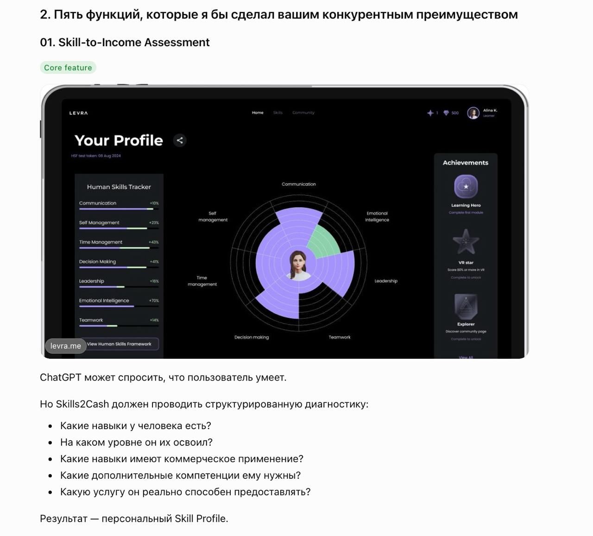

**SKILLS2CASH**

**PRODUCT & TECHNICAL DOCUMENTATION**

*Turn what you know into what you can confidently offer and sell.*

Business Cup 2.0 • Track 03: Skills

US B2C audience • Ages 25–45

Web-only product • 24-hour hackathon MVP

Version 1.0 • November 2026

# 24. UI reference — Personal Skill Profile Dashboard

The team wants the Skills2Cash interface to follow the visual direction of the attached reference: a premium, dark personal skills dashboard with a clear profile overview, skill-by-skill progress indicators, a central radial skill visualization, and an achievements panel.

*Figure 1. User-provided visual reference for the Skills2Cash Skill Profile screen.*

## 24.1 Required layout and visual elements

- **Top navigation:** Brand/logo on the left; primary navigation such as Home, My Skills, Learning Path, and Practice; profile/avatar and progress or reward indicator on the right.

- **Profile header:** A clear page title such as “Your Skill Profile”, a short profile summary, and a last-updated or assessment-completed date.

- **Skill tracker panel:** A compact list of the user's competencies with labels and horizontal progress bars. Example dimensions: communication, time management, decision-making, leadership, teamwork, self-management, and emotional intelligence. For Skills2Cash, also include monetization-specific competencies such as service design, pricing, customer discovery, value communication, and objection handling.

- **Central skill visualization:** A large radial/radar-style chart showing relative strengths and development areas across the selected competency framework. It must be readable and accompanied by labels; do not use the chart as the only way to communicate scores.

- **Achievements panel:** A right-side panel for earned milestones, such as Assessment Completed, First Service Offer, First Client Simulation, Pricing Practice, and Launch Ready. Achievements must be awarded from real completed actions, not decorative fake progress.

- **Progress feedback:** Show skill levels or scores with clear explanations and a visible distinction between self-reported skills and skills demonstrated through completed assignments or simulations.

- **Responsive behavior:** On desktop, use a three-zone dashboard: skill list on the left, radial visualization in the center, achievements on the right. On smaller screens, stack these sections vertically; do not shrink the chart and text until unreadable.

## 24.2 Skills2Cash-specific adaptation

The reference appears to track general human skills. Skills2Cash should preserve the same visual structure but adapt the competency labels to the product's core promise: learning to turn an existing skill into a service that can be offered and sold.

- Skill capability — how well the user can perform the underlying craft or task.

- Service definition — ability to define a specific service, scope, and deliverables.

- Target-customer understanding — ability to identify a customer segment and its problem.

- Pricing rationale — ability to explain a price using scope, effort, costs, and value.

- Value proposition — ability to communicate the outcome and why it matters.

- Client communication — ability to ask questions and communicate professionally.

- Objection handling — ability to respond to price, trust, timing, and scope objections.

- Closing and next steps — ability to agree on a clear and appropriate next action.

## 24.3 Data and scoring rules for this screen

- Display a score only when its source is known. Mark self-reported skill levels separately from AI-evaluated assignment or roleplay evidence.

- Use the same competency definitions and rubric across assessments, assignments, and roleplay sessions so progress can be compared over time.

- Show a short tooltip or detail view explaining what each competency means and what evidence contributed to its score.

- Do not imply that the dashboard predicts income or guarantees business success.

- The radar chart is a visual summary; the exact numeric score, level, and next recommended action must also be available in text.

## 24.4 Claude Code implementation note

Implement this as the primary Skill Profile dashboard screen. Match the composition and visual mood of the attached reference, not its unrelated branding. Use the Skills2Cash design system: near-black background, restrained violet/purple accents, high-contrast typography, subtle borders, compact cards, and accessible labels. Build the layout with responsive reusable components. Use real profile and assessment data where available; provide a clearly labelled demo dataset for the judge walkthrough.

Skills2Cash — Product & Technical Documentation

**Version:** 1.0

**Purpose:** Product source of truth, hackathon build specification, and implementation context for Claude Code

**Track:** Business Cup 2.0 — Track 03: Skills

**Target market:** United States, adults aged 25–45

**Platform:** Web application only (responsive browser experience; no native mobile app)

**Build constraint:** Hackathon MVP designed for a 24-hour build

---

# 1. Executive summary

**Skills2Cash** is an AI-powered, practice-based learning platform that teaches adults how to turn skills they already possess into clearly defined, marketable services.

The platform addresses a gap between having a useful skill and knowing how to monetize it. A person may be good at video editing, graphic design, Excel, writing, photography, event planning, or another practical skill, but may not know:

- what specific service to offer;

- who is likely to need it;

- how to package the service and define its deliverables;

- how to set and justify a price;

- how to present their value;

- how to handle objections and negotiate;

- how to approach potential customers professionally.

Skills2Cash does not promise income or guaranteed customers. It teaches the practical business skills needed to offer and sell a service. The product combines structured assessment, personalized learning, practical assignments, AI roleplay, consistent evaluation, and a readiness profile.

**Core promise:**

\*Turn what you know into what you can confidently offer and sell.\*

**Short positioning statement:**

Skills2Cash is an AI-powered skill-monetization learning platform that helps people identify a service they can offer, learn the business skills needed to sell it, practise with realistic AI customers, and demonstrate their readiness through practical work.

# 2. Hackathon brief and product fit

The challenge brief describes Track 03 — **Skills** as:

> “Learning and growing. What do people fail to master?”

Our interpretation: identify a concrete skill adults struggle to master and build a web product that helps them make measurable progress.

Skills2Cash fits this track by focusing on a connected set of practical skills that many people need but may not know how to develop: monetizing an existing skill. The learning outcomes include:

1.  identifying a skill with potential commercial application;

2.  defining a target customer and customer problem;

3.  packaging a skill into a clear service offer;

4.  pricing the service;

5.  communicating value and presenting the offer;

6.  negotiating and responding to objections;

7.  preparing a professional portfolio/sample and outreach message.

The product should be presented as a **learning product**, not merely a business idea generator, freelancer marketplace, lead database, or generic chatbot.

## Challenge constraints

- Audience: adults in the US, ages 25–45.

- Business model: B2C; sell directly to individuals, not businesses.

- Platform: web only; runs in a browser.

- Product expectation: working end-to-end product, not only a mockup or slide deck.

- Submission items: pitch deck (up to 10 slides), public production URL, public GitHub repository.

- The brief shows a deadline of \*\*12:00, November 15\*\*. Confirm the event timezone and exact deadline with organizers.

The judging slide lists: product/engineering (70%), what is sold/value and retention (20%), problem/user clarity (15%), business potential (15%), and originality (10%). The percentages shown total 130%; treat them as the organizers’ displayed weights/priorities and confirm the scoring method if possible. Product functionality is clearly the dominant priority.

# 3. Problem statement

## Primary problem

People possess skills that could potentially be offered as services, but they often lack the practical knowledge and confidence to turn those skills into a clear offer and sell them.

## Specific pain points

| **User problem**                                                       | **Skill the platform teaches**           |
|------------------------------------------------------------------------|------------------------------------------|
| “I do not know what I could sell.”                                     | Skill-to-Income Discovery                |
| “I do not know who would pay for it.”                                  | Target-customer and problem research     |
| “I cannot explain what exactly I offer.”                               | Service and offer creation               |
| “I do not know how much to charge.”                                    | Pricing and package design               |
| “I do not know how to communicate my value.”                           | Personal selling and value proposition   |
| “I feel uncomfortable talking to clients.”                             | Client communication                     |
| “I do not know how to respond when a client says it is too expensive.” | Objection handling and negotiation       |
| “I do not know how to turn interest into an agreement.”                | Sales conversation and next-step closing |

## Important scope boundary

Skills2Cash is not a promise that every hobby can become profitable, and it does not guarantee a customer, revenue, employment, or a specific market price. AI-generated opportunities and price suggestions are hypotheses that users should validate. The product helps users develop skills and produce practical assets; it does not replace market research, professional judgment, or legal/tax advice.

# 4. Target users

## Primary segment

US adults aged 25–45 who:

- have a job, family responsibilities, or other time constraints;

- want an additional income stream or more autonomy;

- already have one or more professional, creative, technical, or practical skills;

- are interested in freelancing, consulting, or offering a small service;

- lack experience in packaging, pricing, marketing, or selling that service.

## Example personas

**Persona A — The skilled employee**

Age 34. Works full-time and is good at Excel and reporting. Colleagues often ask for help, but the person has never sold this skill independently. Needs help defining a narrow service, identifying a customer type, and pricing the work.

**Persona B — The creative beginner freelancer**

Age 28. Can edit short videos and create social content. Has sample work but struggles to explain the value, handle price objections, and approach potential clients.

**Persona C — The experienced practitioner**

Age 41. Has years of experience in operations or event planning. Wants to package a repeatable service but does not know how to describe scope, deliverables, and pricing.

## Jobs to be done

“When I want to earn from a skill I already have, help me turn it into a specific service, practise the business skills required to sell it, and understand what I still need to improve.”

# 5. Product positioning and differentiation

## Positioning

**Skills2Cash — Turn what you know into what you can confidently offer and sell.**

Alternative tagline: **Learn to monetize the skills you already have.**

## What Skills2Cash is

- A structured learning journey.

- A personalized skill and skill-gap assessment.

- A service-building workspace.

- A practical assignment system.

- An AI customer roleplay simulator.

- A rubric-based progress and readiness dashboard.

## What Skills2Cash is not

- Not a generic ChatGPT wrapper.

- Not a course library built around passive video lessons.

- Not a freelancer marketplace.

- Not a guaranteed lead-generation or customer-acquisition service.

- Not a business-registration, legal, accounting, or tax service.

## Difference from using ChatGPT directly

ChatGPT can already brainstorm services, write proposals, explain pricing, and roleplay a customer when prompted. Skills2Cash should not claim that these individual capabilities are impossible in ChatGPT.

The product-level differentiation is the **integrated learning system**:

8.  A consistent onboarding assessment and skill profile.

9.  A defined competency framework for monetizing a skill.

10. A personalized sequence of learning modules and practical missions.

11. Persistent progress and work samples saved in one profile.

12. Repeatable AI client scenarios with consistent scoring rubrics.

13. Feedback tied to specific competencies and previous attempts.

14. A readiness summary based on completed evidence, not a single AI answer.

**Differentiation statement:**

\*ChatGPT can give advice when asked. Skills2Cash organizes the full learning journey, assigns practice, evaluates evidence against a consistent rubric, remembers progress, and selects the next exercise based on demonstrated skill gaps.\*

Do not claim that ChatGPT cannot do these things. The distinction is the product workflow, consistency, specialization, and user experience.

# 6. Learning framework: Discover → Build → Price → Practice → Launch

The complete product journey has five stages.

## Stage 1 — DISCOVER: Discover your monetizable skills

**Goal:** Help users identify existing skills and choose one realistic service direction to explore.

Inputs:

- skills the user uses at work or in daily life;

- tasks others ask them to help with;

- previous projects or outcomes;

- interests and preferred work;

- experience level and confidence;

- time available per week;

- preferred customer types or industries.

Outputs:

- Personal Skill Profile;

- candidate service directions;

- identified skill gaps;

- one selected skill/service direction for the learning journey.

The AI should explain why a suggested service may fit the user's experience. It must distinguish known facts supplied by the user from assumptions that need validation.

## Stage 2 — BUILD: Learn to create a service

**Goal:** Turn a broad skill into a specific, understandable service offer.

Example transformation:

- Broad skill: “I know graphic design.”

- More specific offer: “I create starter brand identity packages for independent coffee shops.”

The user learns to define:

- target customer;

- customer problem;

- service outcome;

- scope and deliverables;

- process and timeline;

- what is excluded;

- proof/sample work;

- differentiating value proposition.

Output: Service Offer Canvas.

## Stage 3 — PRICE: Learn how to price your work

**Goal:** Teach the user to form a reasoned price and service packages.

The platform should teach:

- time and effort estimation;

- direct costs and tool costs;

- scope and revision limits;

- hourly, fixed-project, or package pricing;

- good/better/best packages where appropriate;

- how to explain price in terms of deliverables and value.

AI price suggestions must be labelled as estimates, not verified market facts. If external market data is not integrated, the product must say that the price is an initial hypothesis and encourage validation.

Output: pricing worksheet and draft packages.

## Stage 4 — PRACTICE: Practise with AI

**Goal:** Help the user rehearse real business conversations in a safe environment.

The AI takes the role of a prospective customer. The user practises selling the service, explaining value, asking clarifying questions, responding to objections, and agreeing on next steps.

Scenario library for the MVP:

- “Your price is too high.”

- “Why should I hire you?”

- “Another freelancer offered a lower price.”

- “Can you do it cheaper?”

- “I need it by tomorrow.”

- “Can you include extra work for free?”

- “I am not sure I need this service.”

- “I need to think about it.”

Each scenario should have:

- customer persona/context;

- scenario goal;

- difficulty;

- objection(s);

- expected competencies;

- evaluation rubric;

- completion criteria.

The simulator should feel like a conversation, not a quiz. For the 24-hour MVP, text-based roleplay is sufficient; voice is optional and should not block launch.

## Stage 5 — LAUNCH: Prepare to sell

**Goal:** Assemble the practical assets needed to start approaching potential customers.

Outputs:

- final service description;

- target customer profile;

- pricing packages;

- sample portfolio/case study;

- short pitch;

- outreach message;

- checklist for validating the offer with real people.

The product may generate a suggested outreach message, but the user must review and send it themselves in the MVP. Do not imply that the platform has contacted customers unless a real, permissioned integration exists.

# 7. Core product features

The longer-term product has five principal capabilities. The 24-hour MVP should implement a narrow, working slice of them.

## 7.1 Skill-to-Income Assessment

Structured onboarding that identifies the user's skills, experience, examples, confidence, and constraints.

**Inputs:** guided questionnaire and short free-text answers.

**AI output:** skill profile, potential service directions, rationale, uncertainties, and suggested next step.

**User control:** user can edit or reject suggestions.

## 7.2 Adaptive Learning Path

A personalized learning path based on the user's selected service and demonstrated gaps.

Example:

- User A can perform graphic design but struggles to sell.

- User B communicates confidently but needs help defining scope and pricing.

They should not receive identical next steps. The learning path should update based on assignment results and simulator scores.

For the MVP, implement a simple deterministic rule system using rubric scores (for example, below 60 = remedial practice; 60–79 = targeted practice; 80+ = advance). Thresholds are initial product settings and should be configurable, not presented as scientifically validated.

## 7.3 AI Client Simulator

A roleplay interface with a scenario library, customer persona, conversation history, evaluation, and recommended next practice.

**MVP interaction:** user sends text; AI responds in character; user ends the session; evaluator returns structured scores and feedback.

## 7.4 Real-World Assignments

Practical missions that produce tangible outputs rather than passive completion.

MVP assignment examples:

15. Write a one-sentence service offer.

16. Define one target customer and their problem.

17. Create three pricing packages or a pricing rationale.

18. Create a sample project or portfolio case.

19. Respond to a simulated customer objection.

Each assignment has a prompt, submission field, rubric, score, feedback, and status.

## 7.5 Monetization Readiness Score

A transparent summary of demonstrated competencies. It is a learning/readiness indicator, not a prediction of income or a guarantee of commercial success.

Suggested dimensions:

- Service clarity;

- target-customer understanding;

- pricing rationale;

- portfolio/proof quality;

- communication;

- objection handling;

- next-step/closing skills.

The score should be derived from completed work and roleplay assessments. Show evidence and feedback beside scores. Avoid implying that an AI score is an objective professional certification.

# 8. MVP scope for the 24-hour hackathon

## MVP objective

A judge should be able to open the web app, complete a short onboarding, receive a skill profile and learning path, complete one practical task, practise a customer conversation, and see a score with feedback.

## Must-have

20. Responsive landing page with clear product positioning.

21. Demo user flow; authentication may be simplified if time is limited.

22. Skill assessment form.

23. AI-generated Skill Profile with editable fields.

24. One selected service direction.

25. Basic learning path with 3–5 steps.

26. Service Builder: target customer, problem, offer, deliverables, and price hypothesis.

27. Text-based AI Client Simulator with at least 3 scenarios.

28. Structured evaluation with rubric scores and actionable feedback.

29. Progress/readiness dashboard.

30. Persistent storage for user profile, session, assignments, and scores, if time permits.

31. Public deployment that opens without requiring a judge to create an account. Provide a demo mode or preloaded demo account.

## Nice-to-have only if the core flow works

- Portfolio page generation.

- Additional roleplay scenarios.

- Voice interaction.

- Public customer/lead discovery.

- Stripe payment integration.

- Email integrations.

- Advanced analytics and gamification.

## Explicitly out of scope for the hackathon MVP

- Full freelancer marketplace.

- Automated outreach or sending messages to prospects.

- Guaranteed customer matching.

- Real-time scraping of business leads.

- Native iOS/Android apps.

- Complex subscription and billing system.

- Large course/video library.

- Multi-tenant enterprise admin.

## Demo acceptance criteria

A judge can:

- understand the value proposition within 10 seconds;

- start without a complicated sign-up process;

- complete the assessment;

- see a personalized skill profile and a plausible service direction;

- see a learning path;

- enter a roleplay and exchange multiple messages with the AI customer;

- finish the session and receive structured scores plus specific feedback;

- see progress/readiness reflected in the dashboard;

- use the product in a browser on a laptop and mobile viewport.

A polished mockup alone does not satisfy the challenge. The main interaction must work end-to-end.

# 9. Recommended technical stack

The following is a pragmatic stack for a fast, maintainable web MVP. The team may substitute tools it already knows, but should avoid changing technologies mid-build without a strong reason.

## Frontend

- \*\*Next.js (App Router) + TypeScript\*\* — application framework and typed codebase.

- \*\*Tailwind CSS\*\* — styling and responsive layout.

- \*\*shadcn/ui\*\* — accessible UI primitives, if useful.

- \*\*Lucide icons\*\* — consistent icon set.

- \*\*React Hook Form + Zod\*\* — form state and validation.

- \*\*Recharts\*\* — simple progress charts, only if needed.

## Backend and data

- \*\*Next.js Route Handlers / Server Actions\*\* — server-side application endpoints.

- \*\*Supabase\*\* — PostgreSQL database and optional authentication.

- \*\*Supabase Storage\*\* — optional portfolio/sample uploads.

- Use server-side access for secrets and privileged database operations.

## AI

- \*\*OpenAI API\*\* — skill profile generation, learning-path recommendations, roleplay responses, assignment feedback, and structured evaluation.

- Use structured JSON outputs validated with Zod.

- Keep prompts and scoring rubrics in version-controlled files.

- Make AI calls server-side; never expose API keys in browser code.

- Set request limits, sensible token limits, and error handling.

- Store relevant outputs and user progress to avoid regenerating everything on every page load.

## Deployment and developer workflow

- \*\*Vercel\*\* — deploy the Next.js web app.

- \*\*GitHub\*\* — public repository for hackathon submission.

- \*\*Environment variables\*\* — manage API keys and database credentials.

- \*\*ESLint + Prettier\*\* — code quality and formatting.

- \*\*Vitest\*\* (optional under time pressure) — unit tests for scoring and validation.

## Suggested stack summary

| **Layer**      | **Technology**        | **Purpose**                      |
|----------------|-----------------------|----------------------------------|
| Web framework  | Next.js + TypeScript  | Responsive web app               |
| Styling        | Tailwind CSS          | UI and responsive design         |
| Components     | shadcn/ui             | Accessible components            |
| Forms          | React Hook Form + Zod | Validation                       |
| Database       | Supabase PostgreSQL   | Profiles, paths, tasks, sessions |
| File storage   | Supabase Storage      | Optional portfolio files         |
| AI             | OpenAI API            | Coaching, roleplay, evaluation   |
| Charts         | Recharts              | Progress visualization           |
| Hosting        | Vercel                | Public production deployment     |
| Source control | GitHub                | Public code repository           |

# 10. High-level architecture

> Browser (Next.js UI)  
> \|  
> \| HTTPS  
> v  
> Next.js Server Routes / Server Actions  
> \| \|  
> \| +---- OpenAI API  
> \| - Skill assessment  
> \| - Learning path  
> \| - Roleplay  
> \| - Assignment evaluation  
> \|  
> +---- Supabase  
> - User profiles  
> - Skill profiles  
> - Learning paths  
> - Assignments/submissions  
> - Roleplay sessions/messages  
> - Scores and feedback

## Architecture principles

- Browser components must not call OpenAI directly.

- Validate all user inputs on the server.

- Validate AI structured outputs before storing or rendering.

- Persist progress so the product feels like a learning platform, not a sequence of disconnected chats.

- Keep roleplay state and rubric evaluation separate: the customer simulator stays in character; the evaluator assesses the conversation after or during the session.

- Add graceful fallback messages if the AI provider or database is unavailable.

- Do not store unnecessary sensitive personal data.

# 11. Suggested data model

A minimal relational schema:

## \`profiles\`

- \`id\` — UUID, primary key; maps to auth user or demo user.

- \`display_name\`

- \`age_range\` — optional broad range, not exact birth date.

- \`weekly_time_available\`

- \`experience_summary\`

- \`created_at\`, \`updated_at\`

## \`skill_profiles\`

- \`id\`

- \`user_id\`

- \`skills\` — JSONB list of skill names and self-reported levels.

- \`evidence\` — JSONB examples/projects supplied by user.

- \`constraints\` — JSONB time/preferences.

- \`ai_summary\`

- \`selected_skill\`

- \`selected_service_direction\`

- \`created_at\`, \`updated_at\`

## \`learning_paths\`

- \`id\`

- \`user_id\`

- \`skill_profile_id\`

- \`title\`

- \`status\`

- \`steps\` — JSONB for the MVP, or normalized \`learning_steps\` table later.

- \`created_at\`, \`updated_at\`

## \`assignments\`

- \`id\`

- \`learning_path_id\`

- \`title\`

- \`description\`

- \`competency\`

- \`rubric\` — JSONB.

- \`order_index\`

## \`assignment_submissions\`

- \`id\`

- \`assignment_id\`

- \`user_id\`

- \`submission_text\`

- \`ai_feedback\` — JSONB.

- \`score\`

- \`status\`

- \`created_at\`

## \`roleplay_scenarios\`

- \`id\`

- \`title\`

- \`customer_persona\`

- \`context\`

- \`difficulty\`

- \`objections\` — JSONB.

- \`rubric\` — JSONB.

- \`is_active\`

## \`roleplay_sessions\`

- \`id\`

- \`user_id\`

- \`scenario_id\`

- \`service_offer_snapshot\` — JSONB.

- \`status\`

- \`started_at\`

- \`ended_at\`

- \`evaluation\` — JSONB.

- \`overall_score\`

## \`roleplay_messages\`

- \`id\`

- \`session_id\`

- \`role\` — \`user\`, \`assistant\`, or \`system\` as appropriate.

- \`content\`

- \`created_at\`

## \`readiness_snapshots\`

- \`id\`

- \`user_id\`

- \`overall_score\`

- \`dimension_scores\` — JSONB.

- \`evidence_summary\` — JSONB.

- \`created_at\`

For the 24-hour build, the team can simplify the schema and use JSONB for learning-path steps and evaluation payloads. Keep user ownership checks and database access policies in place.

# 12. Suggested application routes

| **Route**                    | **Purpose**                   |
|------------------------------|-------------------------------|
| \`/\`                        | Landing page                  |
| \`/onboarding\`              | Skill assessment              |
| \`/dashboard\`               | Overview and progress         |
| \`/profile/skills\`          | Personal Skill Profile        |
| \`/path\`                    | Adaptive Learning Path        |
| \`/service-builder\`         | Offer and pricing builder     |
| \`/practice\`                | Scenario library              |
| \`/practice/\[scenarioId\]\` | AI roleplay session           |
| \`/assignments\`             | Practical missions            |
| \`/assignments/\[id\]\`      | Assignment details/submission |
| \`/readiness\`               | Readiness score and evidence  |

A public demo route such as /demo can load a prepared sample profile and scenario so judges can test the product quickly.

# 13. AI design: prompts, outputs, and evaluation

## General AI behavior

The AI should act as a practical coach, not as a hype-driven business guru.

It should:

- ask for missing context when needed;

- avoid inventing the user's experience or achievements;

- distinguish facts, assumptions, and recommendations;

- explain uncertainty;

- give concrete, actionable feedback;

- avoid guaranteeing income, customers, or market demand;

- keep each learning task focused on one competency;

- encourage users to validate assumptions with real potential customers.

## Structured output approach

Use JSON schemas and server-side validation. Example assessment response:

> {  
> "skill_profile_summary": "The user has experience creating short-form video edits.",  
> "strengths": \["basic editing", "story pacing"\],  
> "gaps": \["offer definition", "pricing rationale", "client communication"\],  
> "service_directions": \[  
> {  
> "name": "Short-form video editing package",  
> "target_customer": "Local service businesses",  
> "problem_solved": "Need consistent short-form social content",  
> "why_it_may_fit": "Based on the user's stated editing experience",  
> "assumptions_to_validate": \["local businesses have budget", "user can meet turnaround expectations"\]  
> }  
> \],  
> "recommended_next_step": "Define a narrow service package"  
> }

## AI Client Simulator: roleplay rules

The simulated customer should:

- stay in character;

- have a clear goal, budget, context, and objection;

- not reveal the ideal answer immediately;

- ask realistic follow-up questions;

- vary difficulty;

- end when the user chooses to end or the scenario completion condition is reached.

The simulator and evaluator should be separate prompt tasks. Do not let the evaluator's coaching notes leak into the customer roleplay.

## Evaluation rubric

Suggested 1–5 scale per dimension:

| **Dimension**              | **What is evaluated**                                                 |
|----------------------------|-----------------------------------------------------------------------|
| Discovery                  | Did the user ask relevant questions and understand the customer need? |
| Value proposition          | Did the user explain the outcome and value clearly?                   |
| Clarity                    | Was the response understandable and specific?                         |
| Pricing rationale          | Could the user explain scope and price without unsupported claims?    |
| Objection handling         | Did the user respond constructively to concerns?                      |
| Professional communication | Was the tone respectful and confident?                                |
| Next step                  | Did the user propose a clear, appropriate next action?                |

Convert the rubric to a 0–100 display only with a documented formula. Show dimension scores and evidence-based feedback. Avoid scoring personality traits such as “confidence” as if they were objectively measurable from text alone; evaluate observable communication behaviors instead.

## Example evaluation output

> {  
> "overall_score": 78,  
> "dimensions": {  
> "discovery": 4,  
> "value_proposition": 4,  
> "clarity": 5,  
> "pricing_rationale": 2,  
> "objection_handling": 3,  
> "professional_communication": 4,  
> "next_step": 3  
> },  
> "strengths": \[  
> "Clearly explained the service deliverables"  
> \],  
> "improvements": \[  
> "Ask what outcome matters most before defending the price",  
> "Explain the scope and revision limits"  
> \],  
> "recommended_next_practice": "Price objection — intermediate"  
> }

# 14. UX and visual direction

The reference direction discussed by the team uses a modern, premium SaaS interface with dark navy/black surfaces, purple/violet accents, clear cards, progress indicators, and readable typography.

## Design principles

- Premium but functional; do not sacrifice readability for visual effects.

- Clear hierarchy and one primary action per screen.

- Responsive layout; desktop-first for the hackathon demo, but usable on mobile browser.

- Show progress, next action, and evidence of learning.

- Avoid cluttered dashboards.

- Use accessible contrast and visible focus states.

- Provide loading, empty, and error states.

- Keep the AI roleplay interface central and easy to demonstrate.

## Suggested navigation

- Dashboard

- My Skills

- Learning Path

- Service Builder

- Practice

- My Progress

## Key screens

32. Landing page: problem, promise, CTA, example outcome.

33. Onboarding: short guided skill assessment.

34. Skill Profile: strengths, candidate services, gaps.

35. Learning Path: ordered modules and missions.

36. Service Builder: customer, problem, offer, deliverables, price.

37. AI Client Simulator: scenario, conversation, end session.

38. Results: rubric scores, strengths, improvement areas, next practice.

39. Readiness dashboard: progress and evidence.

# 15. Business model hypotheses

The product is B2C. Possible models to test after the hackathon:

- Freemium: free initial assessment and limited practice; paid access to more learning paths and roleplay sessions.

- One-time purchase: a focused “Monetize Your Skill” learning program.

- Subscription: ongoing practice, additional scenarios, progress history, and new learning modules.

Do not invent traction or claim validated willingness to pay. During the hackathon, pricing can be a hypothesis, for example a one-time program price or a low monthly subscription. Validate through interviews, landing-page tests, or pre-orders before treating it as a fact.

Potential value metrics:

- assessment completion rate;

- learning-path step completion;

- assignment completion;

- repeat roleplay sessions;

- improvement across repeated rubric dimensions;

- percentage of users who produce a complete service offer;

- percentage who conduct a real-world customer validation conversation.

# 16. Validation plan

Before or after the demo, interview 5–10 people in the target segment. Ask about past behavior, not only opinions.

Suggested questions:

40. Have you ever wanted to earn extra income using a skill you already have?

41. What did you try, and what happened?

42. What was hardest: choosing a service, finding customers, pricing, presenting your value, or handling objections?

43. Have you paid for a course, coach, or tool to solve this?

44. What did you still struggle with after using it?

45. Would you practise selling your service with an AI customer simulator? Why or why not?

46. What result would make this product worth paying for?

Avoid leading questions such as “Would you love our platform?” Ask for examples and evidence of actual behavior.

# 17. 24-hour execution plan

| **Time block** | **Priority**       | **Deliverable**                                      |
|----------------|--------------------|------------------------------------------------------|
| Hours 0–2      | Align and scope    | Final user journey, design direction, task ownership |
| Hours 2–4      | Foundation         | Next.js app, repo, Supabase, deployment skeleton     |
| Hours 4–8      | Core UI            | Landing, onboarding, dashboard, skill profile        |
| Hours 8–12     | AI assessment      | Structured assessment and service direction          |
| Hours 12–16    | Killer feature     | Working text-based AI Client Simulator               |
| Hours 16–18    | Evaluation         | Rubric scoring, feedback, next practice              |
| Hours 18–20    | Persistence/polish | Save profile/session, progress UI, error states      |
| Hours 20–22    | Submission         | Public deployment, public GitHub, pitch deck         |
| Hours 22–24    | Rehearsal          | Test judge flow, fix blockers, rehearse demo         |

## Suggested team workstreams

Assign based on actual team size and strengths:

- Product/UX: flow, copy, visual system, demo story.

- Frontend: pages, components, forms, roleplay interface.

- Backend/AI: API routes, prompts, schemas, database.

- Integration/QA: connect flow, test end-to-end, deploy, prepare pitch.

If the team is small, combine roles but keep one person responsible for integration and final deployment.

# 18. Demo script for judges (2–3 minutes)

**Opening (15 seconds):**

“Many people have skills they could offer as services, but they don't know how to package, price, or sell them. Skills2Cash teaches the business skills required to monetize an existing skill.”

**User scenario (20 seconds):**

“Meet Alex. Alex can edit short-form videos but has never sold this service.”

**Assessment (25 seconds):**

“Alex completes a short assessment. Skills2Cash identifies strengths and gaps and recommends a focused service direction.”

**Learning path and service builder (25 seconds):**

“Alex learns to define a customer, package deliverables, and build a pricing rationale.”

**AI Client Simulator (45 seconds):**

“Now Alex practises with a customer who says another freelancer is cheaper. The simulator responds as a customer, while the platform evaluates Alex's observable sales skills.”

**Feedback and progress (25 seconds):**

“Alex receives rubric-based feedback, sees what to improve, and gets the next practice task.”

**Close (15 seconds):**

“ChatGPT can answer a question. Skills2Cash turns skill monetization into a structured learning journey with practice, evidence, and measurable progress.”

Only demonstrate features that actually work in the deployed product. If something is simulated or preloaded, label it as a demo.

# 19. Risks and mitigations

| **Risk**                                        | **Mitigation**                                                                 |
|-------------------------------------------------|--------------------------------------------------------------------------------|
| Product looks like a generic AI wrapper         | Make the learning journey, rubric, saved progress, and assignments visible     |
| Scope too large for 24 hours                    | Build one end-to-end path and one polished roleplay                            |
| AI gives generic or inaccurate advice           | Use structured prompts, rubrics, validation, and clear uncertainty labels      |
| Price suggestions look like factual market data | Label as hypotheses; require external validation                               |
| Readiness score looks misleading                | Show evidence, dimensions, and limitations                                     |
| No real customers are found                     | Do not promise customer acquisition; focus on learning and user-led validation |
| AI API fails during demo                        | Provide graceful fallback and a clearly labelled preloaded demo scenario       |
| Judge cannot access product                     | Public URL, demo mode, no mandatory account creation                           |
| Secrets leak into frontend/repository           | Server-side API calls, environment variables, secret scanning                  |

# 20. Security, privacy, and responsible AI

- Keep API keys and service-role keys server-side.

- Never commit \`.env\` files or secrets.

- Validate and sanitize user inputs.

- Use Supabase Row Level Security for user-owned records.

- Do not collect sensitive personal data unless essential.

- Let users edit or delete profile content where supported.

- Make it clear that AI feedback can be imperfect.

- Do not fabricate customer demand, testimonials, credentials, or market statistics.

- Do not guarantee income, customers, or business success.

- Clearly label generated portfolio work as a sample/concept unless it reflects a real project.

- Ensure the simulated customer is clearly identified as AI.

# 21. Definition of done

The hackathon MVP is ready when:

- [ ] The public web URL loads reliably.

- [ ] The landing page explains the product and target user.

- [ ] A user can complete the assessment.

- [ ] The app produces a structured skill profile.

- [ ] The app recommends a specific service direction with assumptions visible.

- [ ] The user can see a learning path.

- [ ] The user can create or edit a service offer.

- [ ] The user can complete at least one practical assignment.

- [ ] The user can complete a multi-turn AI client roleplay.

- [ ] The app produces rubric-based feedback and a score.

- [ ] The dashboard reflects the user's activity.

- [ ] A judge can try the core experience without a complicated signup.

- [ ] The GitHub repository is public and contains setup instructions.

- [ ] The pitch deck has no more than 10 slides.

- [ ] The demo has been rehearsed and all shown features work.

# 22. Claude Code — implementation instructions

The following is the master instruction to provide to Claude Code alongside this document.

## Master prompt

You are the senior full-stack engineer responsible for implementing Skills2Cash, an AI-powered skill-monetization learning platform.

Treat this document as the product and technical source of truth. Build a real, responsive web application, not a static mockup.

**Product goal:** Help adults turn existing skills into marketable services by teaching service creation, target-customer research, pricing, communication, negotiation, and sales through personalized learning and practical AI roleplay.

**Hackathon constraints:**

- US B2C audience, ages 25–45.

- Web-only product.

- Prioritize a working end-to-end MVP that can be built and demonstrated within the available hackathon time.

- Do not build a marketplace, automated lead scraper, native app, or unnecessary enterprise features.

**Preferred stack:**

- Next.js App Router

- TypeScript

- Tailwind CSS

- shadcn/ui where useful

- Supabase PostgreSQL

- OpenAI API called only from server-side routes/actions

- Zod for validation

- Vercel deployment

**Core MVP flow:**

47. Landing page.

48. Skill assessment.

49. Skill profile and one recommended service direction.

50. Personalized learning path.

51. Service builder (target customer, problem, offer, deliverables, pricing hypothesis).

52. AI Client Simulator with multi-turn text conversation.

53. Structured evaluation using a consistent rubric.

54. Progress/readiness dashboard with next recommended practice.

**Implementation rules:**

- First inspect the existing repository and report its current structure before changing files.

- If the repository is empty, scaffold the app using the preferred stack.

- Before coding, propose a short implementation plan and identify the smallest end-to-end slice.

- Build the working core flow before decorative features.

- Use reusable components and a clear folder structure.

- Use strict TypeScript; avoid \`any\` unless justified.

- Validate forms and AI outputs with Zod.

- Keep all secrets on the server and use environment variables.

- Never expose OpenAI or Supabase service-role secrets in client code.

- Persist user progress where practical; support a demo mode if authentication would slow down judging.

- Include loading, empty, error, and retry states.

- Make the UI responsive and accessible.

- Use a premium, modern SaaS visual direction: dark navy/near-black surfaces, violet/purple accents, clean cards, clear typography, subtle gradients, and strong contrast. Avoid excessive glow or clutter.

- Do not invent market statistics, customer leads, testimonials, or guaranteed earnings.

- Label AI-generated prices and opportunities as hypotheses that need validation.

- Keep the AI customer simulator separate from the evaluator. The customer AI stays in character; the evaluator returns structured feedback after the session.

- Implement a deterministic scoring calculation from validated rubric dimensions; do not rely on arbitrary unstructured scores.

- Provide a preloaded demo profile/scenario so judges can test quickly.

- Add a README with setup, environment variables, database setup, run commands, and deployment steps.

- Keep the project deployable throughout development.

**Suggested build order:**

55. Inspect repo and scaffold.

56. Build app shell, navigation, landing page.

57. Build assessment form and server-side assessment endpoint.

58. Build profile and learning path UI.

59. Build service builder.

60. Build scenario library and multi-turn simulator.

61. Build evaluation endpoint and rubric results.

62. Connect persistence and dashboard.

63. Add demo mode, responsive polish, error states.

64. Test the complete judge journey and update README.

**Expected output:**

- Working Next.js application.

- Clear source structure.

- \`.env.example\` with placeholder variable names only.

- Supabase SQL/schema or migration files.

- README with exact local setup steps.

- No committed secrets.

- A deployed, judge-friendly demo if deployment credentials are available.

Do not claim a feature is complete until it has been implemented and tested. If a requirement cannot be completed within the time budget, explain the trade-off and preserve the core end-to-end flow.

## Suggested environment variables

> NEXT_PUBLIC_SUPABASE_URL=  
> NEXT_PUBLIC_SUPABASE_ANON_KEY=  
> SUPABASE_SERVICE_ROLE_KEY=  
> OPENAI_API_KEY=  
> OPENAI_MODEL=  
> NEXT_PUBLIC_APP_URL=

Only add variables actually used by the implementation. Never put private keys in NEXT_PUBLIC\_ variables.

# 23. Recommended final product statement

**Skills2Cash teaches people how to monetize the skills they already have. Through personalized learning paths, practical assignments, and realistic AI client simulations, users learn to turn their abilities into clear service offers, price their work, communicate value, and handle customer objections.**

**The outcome is not a promise of income. It is a stronger, demonstrable ability to offer and sell a service.**
