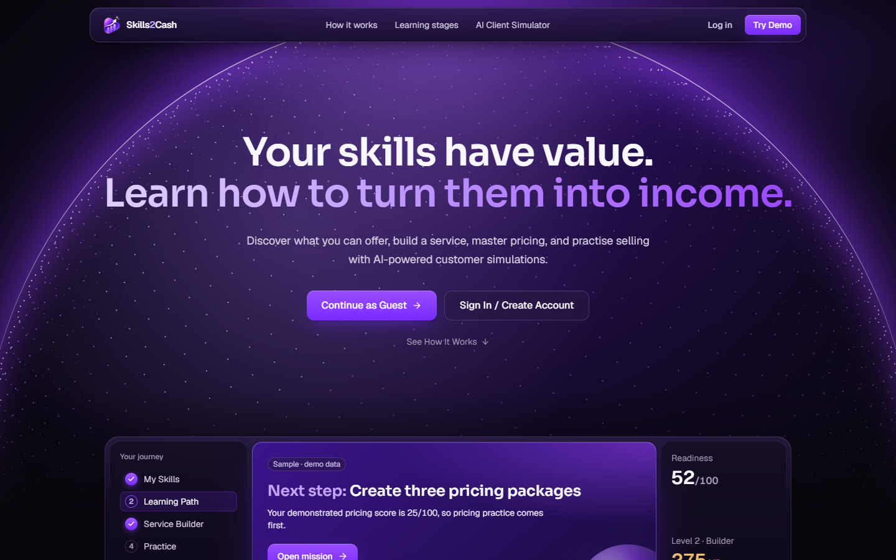
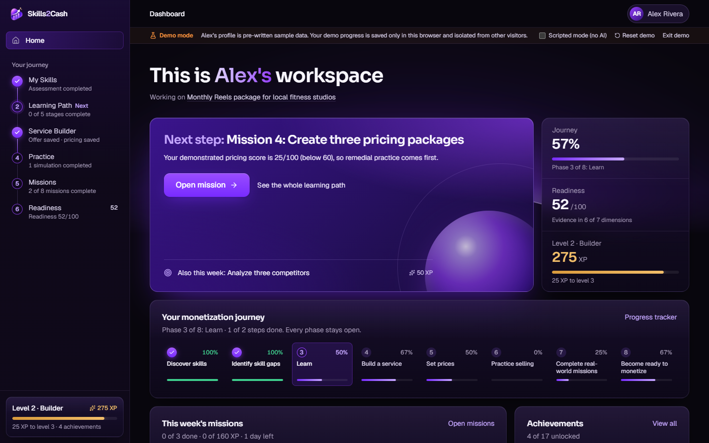
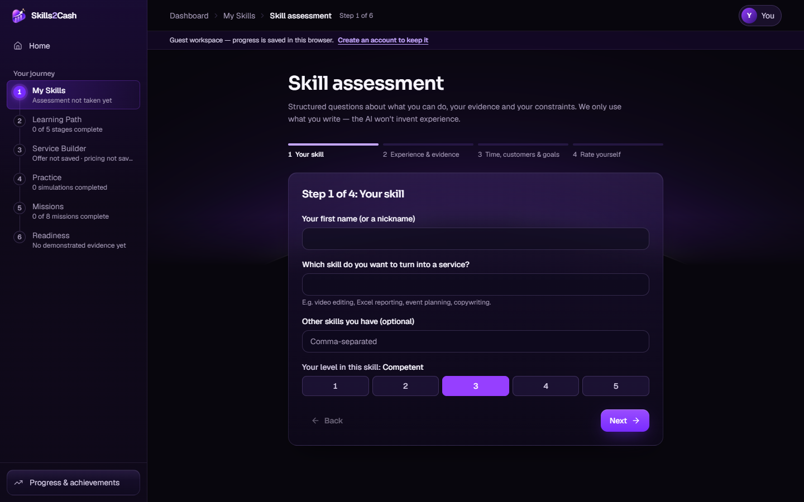
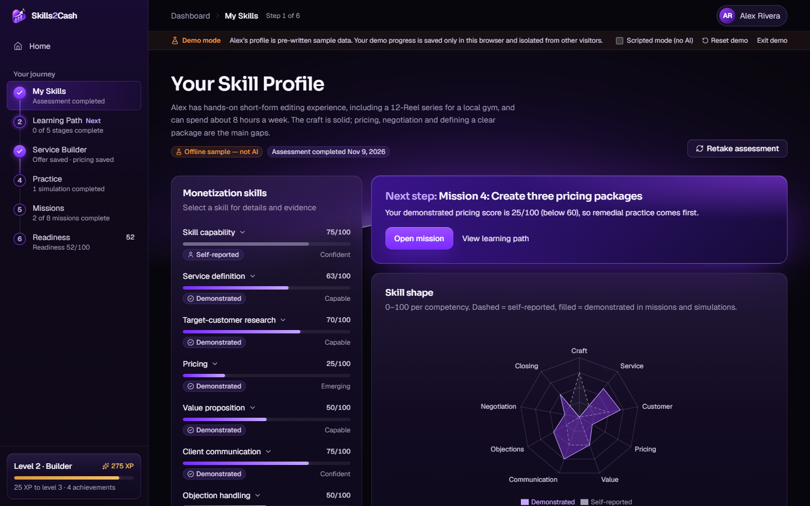
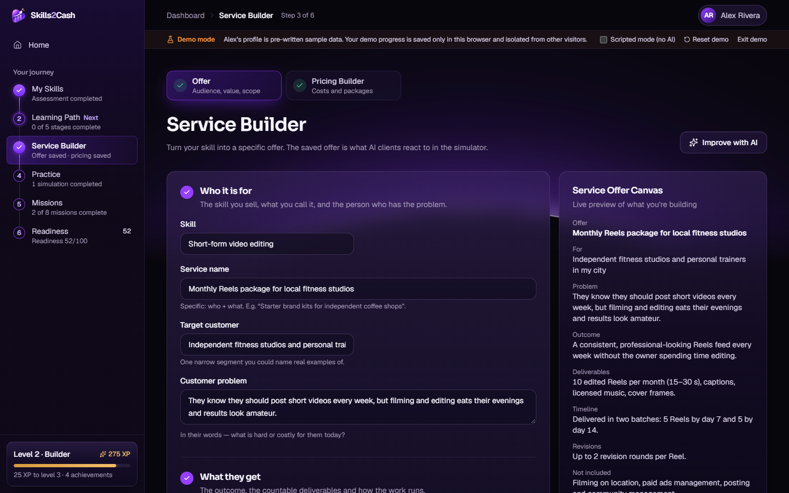
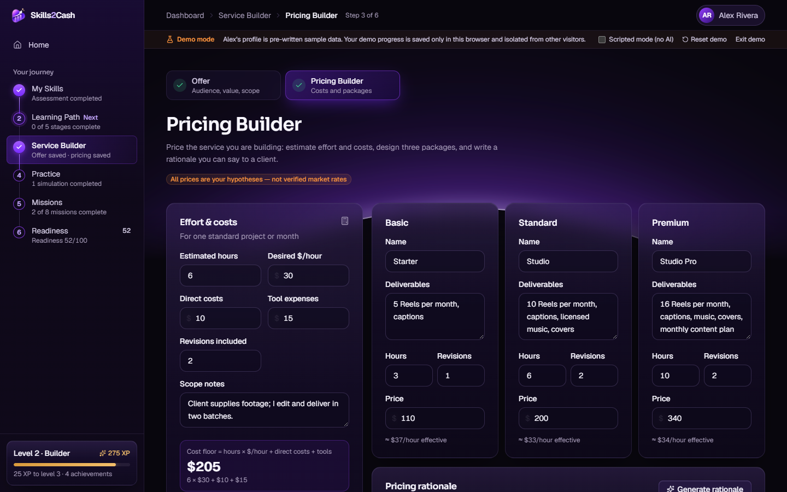
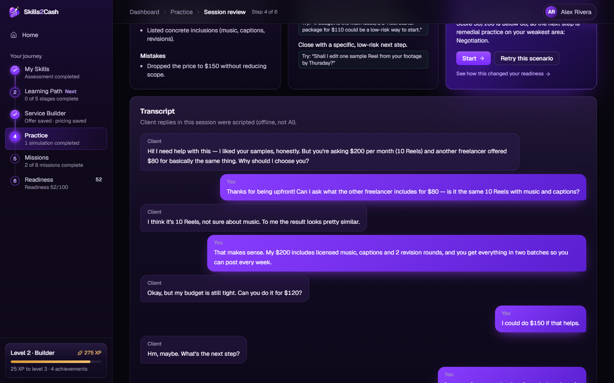
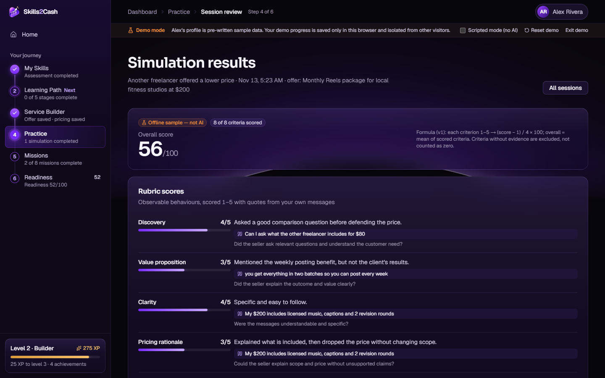
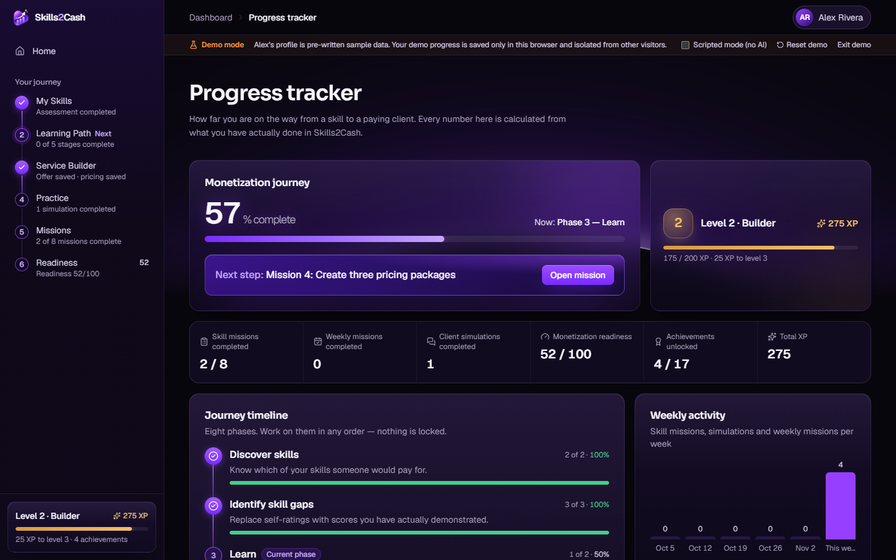
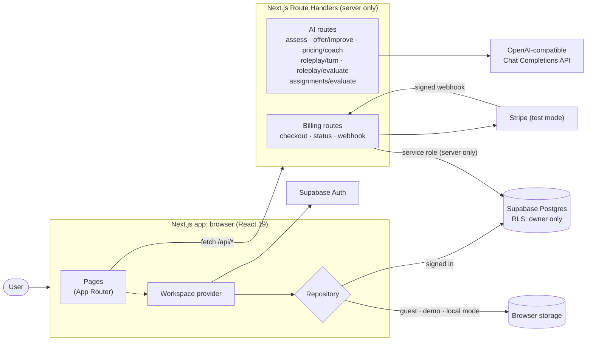

<p align="center">
  
</p>

<h1 align="center">Skills2Cash</h1>

<p align="center">
  <strong>Turn the skills you already have into a service you can confidently price and sell.</strong>
</p>

<p align="center">
  An AI-powered, practice-based learning platform that guides you from <em>"I'm good at this"</em> to a clearly defined, priced service, and lets you rehearse selling it to realistic AI clients before you talk to real ones.
</p>

<p align="center">
  <a href="https://skills2cash-dncv.vercel.app"><strong>🚀 Live app</strong></a>
  &nbsp;·&nbsp;
  <a href="https://skills2cash-dncv.vercel.app/demo"><strong>Try the demo (no sign-up)</strong></a>
  &nbsp;·&nbsp;
  <a href="#-getting-started">Run locally</a>
  &nbsp;·&nbsp;
  <a href="PROJECT_DOCUMENTATION.md">Product spec</a>
</p>

<p align="center">
  
  
  
  
  
</p>

<p align="center">
  
</p>

---

## 📌 Contents

[About](#-about-the-project) · [Problem](#-the-problem) · [Solution](#-our-solution) · [Features](#-key-features) · [How it works](#-how-it-works) · [Screenshots](#-product-screenshots) · [Tech stack](#-technology-stack) · [Architecture](#-system-architecture) · [Getting started](#-getting-started) · [Environment](#-environment-variables) · [Database](#-database-and-migrations) · [Structure](#-project-structure) · [Roadmap](#-roadmap) · [Team](#-team) · [Contributing](#-contributing) · [License](#-license) · [Contact](#-contact)

---

## 💡 About the project

**Skills2Cash** is a B2C web app for adults who have a practical skill (video editing, Excel reporting, copywriting, event planning…) but have never sold it as a service.

It isn't a course library or a marketplace. It's a guided workspace where you:
- assess what you can really do
- shape it into a specific offer
- price that offer
- practise the client conversation with an AI that plays the customer

A separate AI then scores your performance against a fixed rubric.

**Who it's for.** Adults aged 25–45, with the United States as the initial market, especially:
- 👩‍💼 **Employees** looking for an additional income stream
- 🧭 **Aspiring freelancers** preparing their first offer
- 🔄 **Career changers** testing whether a skill can pay
- 🛠️ **People with practical skills but no business experience**

**Why we built it.** A general chatbot can give advice when asked. It doesn't organise the whole journey, assign practice, assess your work against a consistent rubric, remember your progress, or choose the next exercise based on the gaps you've actually shown. Skills2Cash does all of that. It was created for **Business Cup 2.0 · Track 03: Skills** (see [`PROJECT_DOCUMENTATION.md`](PROJECT_DOCUMENTATION.md)).

> Skills2Cash is a learning product. It makes no income promises, does no lead generation, and never contacts anyone on your behalf. Prices are always presented as hypotheses to validate.

---

## 🧩 The problem

People with valuable skills often stall before earning anything from them:

| Challenge | What it looks like |
| --- | --- |
| **Not knowing what's sellable** | *"I'm good at several things. Which one would someone actually pay for?"* |
| **No clear service** | A skill isn't an offer. Who is it for, what's delivered, by when, and what's excluded? |
| **Pricing paralysis** | Guessing a number, then underpricing out of fear |
| **Low confidence with clients** | Freezing on *"another freelancer is cheaper"* or *"can you do it for less?"* |
| **No safe place to practise** | The first real client conversation is also the first rehearsal |

---

## ✨ Our solution

Skills2Cash connects the whole monetisation journey into **one guided experience**. Each step feeds the next.

```text
 1. Discover          2. Build             3. Price             4. Practise          5. Track & improve
 ───────────          ────────             ────────             ───────────          ──────────────────
 Skill assessment  →  Service Builder   →  Pricing Builder   →  AI Client         →  Readiness, missions,
 + AI Skill Profile   (a specific offer)   (cost floor +        Simulator +          XP, achievements and
                                           3 packages)          rubric scoring       an adaptive next step
```

- **Shared data:** the offer you build is exactly what the AI clients react to, and every evaluation updates your demonstrated skills.
- **Adaptive next step:** the recommendation always targets your weakest *demonstrated* area, not what you said about yourself.

---

## 🚀 Key features

**Status legend:** ✅ implemented and verifiable in the codebase · 🟡 partially implemented (see notes)

| | Feature | What it does | What you get |
| --- | --- | --- | --- |
| ✅ | **Skill assessment** (`/onboarding`) | A 4-step questionnaire (your skill, experience and evidence, time and goals, self-ratings), followed by an AI Skill Profile | It separates facts from assumptions and identifies strengths and gaps. It suggests 1–3 service directions with a price hypothesis, which you can edit, reject or replace with your own |
| ✅ | **My Skills profile** (`/profile/skills`) | A skills tracker, a radar chart and achievements | It shows clearly which scores are **self-reported** and which are **demonstrated** in missions and simulations |
| ✅ | **Learning Path** (`/path`) | Five stages: Discover → Build → Price → Practise → Launch | Objectives, a lesson, an example and completion criteria for each stage, plus an adaptive recommendation |
| ✅ | **Service Builder** (`/service-builder`) | A structured offer canvas: customer, problem, outcome, deliverables, scope, timeline, revisions, value proposition and exclusions | A concrete, sellable offer. **Improve with AI** suggests edits field by field |
| ✅ | **Pricing Builder** (`/service-builder/pricing`) | Hours × rate + costs gives a cost floor. You then design Basic, Standard and Premium packages | A price you can explain, with an AI pricing coach for the rationale, risks and how to validate it |
| ✅ | **AI Client Simulator** (`/practice`) | 7 negotiation scenarios, from Beginner to Advanced, against an in-character AI client | Safe rehearsal of real objections (price pushback, discount requests, scope creep, rush jobs…) |
| ✅ | **Rubric evaluation** (`/practice/session/[id]`) | A **separate** AI evaluator scores 8 criteria on a 1–5 scale after you end the session | Quotes from your own messages, mistakes, better example lines and a recommended next exercise |
| ✅ | **Skill missions** (`/assignments`) | 8 practical missions, each with a rubric, AI feedback, a score and attempt history | Real evidence of skill, not self-assessment |
| ✅ | **Readiness** (`/readiness`) | 7 readiness dimensions calculated **only** from demonstrated evidence, with a history chart | An honest view of how close you are to selling |
| ✅ | **Progress tracker** (`/progress`) | An 8-phase journey with percentages, milestones, weekly activity, your level and XP history | Momentum you can see, calculated from saved activity |
| ✅ | **Achievements & XP** | 17 achievements earned from stored actions. XP is a ledger, and each reward is paid only once | Motivation that can't be gamed by clicking |
| 🟡 | **Weekly missions** (`/assignments/weekly`) | 2–4 personalised real-world tasks per week, completed with a short note, each with an XP reward | Fully implemented in the app. Saving them to the database needs two migrations to be applied; until then they're kept in the browser, with a notice (see [Database](#-database-and-migrations)) |
| ✅ | **Accounts** (`/login`, `/signup`) | Supabase email and password sign-in. Signed-out users are sent to sign in | Progress saved to your account and protected by Row Level Security |
| ✅ | **Guest Mode** (`/guest-start`) | Use the app without an account. Progress stays in your browser | After you sign in, a single click transfers your guest progress. Nothing is overwritten and retries never create duplicates |
| ✅ | **Demo mode** (`/demo`) | A sample persona ("Alex") with labelled, pre-written data and the real simulator | Explore everything in minutes. Each visitor gets an isolated copy |
| 🟡 | **Plans & billing** | Free and Pro ($19/month) through Stripe Checkout in **test mode**, with signature-verified webhooks | Free-plan limits are enforced in **Guest Mode only**. Signed-in accounts are not yet restricted by plan. See [`docs/billing.md`](docs/billing.md) |

**Built-in honesty and resilience:**
- **Labelled content:** every AI output is labelled as AI-generated. Offline samples are labelled *"Offline sample — not AI"* and are offered only as an explicit choice, or automatically in demo mode.
- **Checked AI output:** every AI route validates its input and output with Zod. It has a 30-second timeout, one repair retry for invalid output, and a best-effort rate limit of 30 requests per minute per IP.
- **Transparent scoring:** readiness and the adaptive path are deterministic code, not AI calls. The formulas are in [`docs/scoring.md`](docs/scoring.md).

---

## 🧭 How it works

> **Illustrative example**, not a real customer story.

**Scenario:** Maya knows short-form social media content and wants extra income on weekends.

1. **Assess.** Maya answers the structured questionnaire. Her AI Skill Profile highlights short-form video editing as her strongest sellable skill and flags pricing and negotiation as gaps.
2. **Choose a direction.** She picks the suggested direction *"short-form videos for small local businesses"* and narrows it down.
3. **Build the offer.** In the Service Builder she defines *"10 edited Reels per month for independent fitness studios"*, with deliverables, a timeline, revisions and exclusions.
4. **Price it.** The Pricing Builder shows her cost floor and helps her design three packages. The AI coach explains the risks and how to test the price.
5. **Practise.** In the AI Client Simulator a studio owner says *"another freelancer offered this for $80"*. Maya responds, ends the session, and gets rubric scores with quotes from her own messages.
6. **Improve.** Her readiness updates from that evidence, and the app recommends the next exercise: remedial negotiation practice. Weekly missions and achievements keep her moving.

---

## 🖼️ Product screenshots

Captured from the current codebase. App pages use **demo mode** (the labelled sample persona "Alex"), and the assessment uses a fresh guest session.

<table>
  <tr>
    <td width="50%"><p align="center"><sub><b>Dashboard</b>: next step, journey, readiness, level</sub></p></td>
    <td width="50%"><p align="center"><sub><b>Skill assessment</b>: structured 4-step questionnaire</sub></p></td>
  </tr>
  <tr>
    <td><p align="center"><sub><b>My Skills</b>: self-reported vs. demonstrated, skill radar</sub></p></td>
    <td><p align="center"><sub><b>Service Builder</b>: structured offer with live canvas</sub></p></td>
  </tr>
  <tr>
    <td><p align="center"><sub><b>Pricing Builder</b>: cost floor and three packages</sub></p></td>
    <td><p align="center"><sub><b>AI Client Simulator</b>: a negotiation transcript</sub></p></td>
  </tr>
  <tr>
    <td><p align="center"><sub><b>Evaluation</b>: rubric scores with your own quotes</sub></p></td>
    <td><p align="center"><sub><b>Progress tracker</b>: journey, XP, weekly activity</sub></p></td>
  </tr>
</table>

---

## 🛠️ Technology stack

| Layer | Technology |
| --- | --- |
| **Frontend** | [Next.js 15](https://nextjs.org) (App Router) · React 19 · TypeScript (strict) |
| **Styling & UI** | Tailwind CSS v4 (`@theme` design tokens) · in-house shadcn-style primitives ([`src/components/ui.tsx`](src/components/ui.tsx)) · [Lucide](https://lucide.dev) icons · [Recharts](https://recharts.org) |
| **Validation** | [Zod](https://zod.dev) for AI inputs and outputs, forms and API payloads |
| **Backend** | Next.js Route Handlers (`src/app/api/*`), server-only |
| **Database** | [Supabase](https://supabase.com) PostgreSQL with Row Level Security on every user table |
| **Authentication** | Supabase Auth (email and password). Guest and demo modes use browser storage |
| **AI** | OpenAI Chat Completions API in JSON mode (default model `gpt-4o-mini`), called with `fetch` from the server. Any OpenAI-compatible endpoint works through `OPENAI_BASE_URL` |
| **Payments** | [Stripe](https://stripe.com) Checkout and webhooks, test mode |
| **Deployment** | [Vercel](https://vercel.com) |
| **Tooling** | npm · ESLint 9 (`eslint-config-next`) · `tsc` · Node's built-in test runner via `tsx` |

---

## 🏗️ System architecture

The browser talks to Supabase directly with the public anon key, and **Row Level Security** limits every row to its owner. AI and billing secrets stay on the server, in Next.js Route Handlers.



**Key design decisions:**
- **Two AI roles.** The AI client sees only its persona and hidden priorities. The rubric lives only in the evaluator, which runs as a separate request.
- **Deterministic scoring.** Readiness, the adaptive path, levels and achievements are plain TypeScript in `src/lib`, so they're reproducible and unit-tested.
- **One data interface.** `SupabaseRepository` and `LocalRepository` implement the same interface, so account, guest, demo and local modes share every screen.

---

## ⚡ Getting started

### Prerequisites

- **Node.js ≥ 20.9** (see `engines` in [`package.json`](package.json)) and **npm**
- *Optional:* an OpenAI-compatible API key for live AI
- *Optional:* a Supabase project for accounts

### 1. Clone and install

```bash
git clone https://github.com/Aruzhan233/skills2cash.git
cd skills2cash
npm install
```

### 2. Configure the environment

```bash
cp .env.example .env.local
```

Every variable is optional for a first run. Without them the app still runs fully:
- **Without Supabase:** **local mode** saves progress in the browser.
- **Without an AI key:** the AI routes report `503 not_configured`, and the UI offers clearly labelled offline samples.

### 3. Run the development server

```bash
npm run dev            # http://localhost:3000
```

Open `/demo` to explore with sample data, or **Continue as Guest** on the landing page.

### 4. Quality checks and production build

```bash
npm run lint           # ESLint
npm run typecheck      # tsc --noEmit
npm run test           # unit tests (node:test via tsx)
npm run build          # production build
npm run start          # serve the production build
npm run check          # lint + typecheck + test + build
```

`GET /api/health` reports whether AI and Supabase are configured, as booleans only.

---

## 🔐 Environment variables

All variable names are listed in [`.env.example`](.env.example). **Never commit `.env.local`**; it is git-ignored.

| Variable | Scope | Purpose |
| --- | --- | --- |
| `OPENAI_API_KEY` | 🔒 server | Live AI for all 6 AI routes. Without it, they return `503 not_configured` |
| `OPENAI_MODEL` | 🔒 server | Optional. Defaults to `gpt-4o-mini` |
| `OPENAI_BASE_URL` | 🔒 server | Optional OpenAI-compatible base URL. Defaults to `https://api.openai.com/v1` |
| `NEXT_PUBLIC_SUPABASE_URL` | 🌐 public | Accounts and cloud persistence |
| `NEXT_PUBLIC_SUPABASE_ANON_KEY` | 🌐 public | Accounts and cloud persistence. Safe to expose, because every user table is protected by RLS |
| `STRIPE_SECRET_KEY` | 🔒 server | Stripe test-mode secret (`sk_test_…`) |
| `STRIPE_PUBLISHABLE_KEY` | 🌐 public | Reserved. Not read by the code yet |
| `STRIPE_WEBHOOK_SECRET` | 🔒 server | Verifies Stripe webhook signatures |
| `STRIPE_PRICE_ID` | 🔒 server | Test Price. Checkout checks it is exactly $19 USD/month |
| `SUPABASE_SERVICE_ROLE_KEY` | 🔒 server | Used **only** by the verified Stripe webhook. Never expose it to the browser |

---

## 🗄️ Database and migrations

**Supabase PostgreSQL** with Row Level Security. Migrations live in [`supabase/migrations/`](supabase/migrations) and run in filename order:

| Migration | Creates |
| --- | --- |
| `20261114000000_init.sql` | Core schema: 11 tables, indexes, constraints, triggers and RLS policies |
| `20261114000100_seed.sql` | Mission and scenario catalog (generated from `src/lib` by `npm run db:seed-sql`) |
| `20261114000200_billing.sql` | `subscriptions`: the owner can read it, clients can't write to it |
| `20261114000300_grants.sql` | Explicit Data API grants (RLS still decides which rows each user can access) |
| `20261115000000_retention.sql` | `weekly_missions` and the `xp_transactions` ledger |
| `20261115000100_retention_integrity.sql` | `complete_weekly_mission()`, which completes a mission and pays its XP in one step, exactly once; it also adds guard rules and the `user_xp_summary` view |

**Main entities.** Every user table references `auth.users` (through `user_id`, or `id` for `profiles`) and has owner-only policies.

```text
auth.users ─┬─ profiles                (1:1)
            ├─ skill_profiles          (1:1)  assessment + AI result
            ├─ learning_paths          (1:1)
            ├─ service_offers          (1:1)  ─┐
            ├─ pricing_worksheets      (1:1)   │ offer snapshot is copied into each session
            ├─ roleplay_sessions       (1:n)  ◄┘ ── roleplay_messages (1:n)
            ├─ assignment_submissions  (1:n)  ── assignments (catalog, read-only)
            ├─ readiness_snapshots     (1:n)
            ├─ weekly_missions         (1:n)
            ├─ xp_transactions         (1:n)  unique (user, source, ref)
            └─ subscriptions           (1:1)
roleplay_sessions ── roleplay_scenarios (catalog, read-only)
```

Evidence tables (submissions, messages, snapshots) only allow insert, read and delete. A simulation session can only be updated while it is active.

> ⚠️ **Pending migrations.** At the time of writing, the two retention migrations (`20261115000000_retention.sql` and `20261115000100_retention_integrity.sql`) have **not yet been applied** to the project's hosted Supabase instance. Until they are, weekly missions and XP for signed-in users are kept in the browser, and the app says so. They move into the database automatically once the migrations are applied.

### Applying migrations

**Option A: Supabase Dashboard.** Open **SQL Editor** and run each file in filename order.

**Option B: Supabase CLI.**

```bash
supabase link --project-ref <your-project-ref>
supabase db push
```

If some migrations were already applied by hand in the Dashboard, mark them as applied first with `supabase migration repair --status applied <version>`, so `db push` doesn't try to re-run them.

**Auth settings.**
- Enable **Email** under *Authentication → Providers*.
- Add your site URL, for example `https://skills2cash-dncv.vercel.app`, under *Authentication → URL configuration*.

---

## 📁 Project structure

```text
skills2cash/
├── src/
│   ├── app/
│   │   ├── page.tsx              # landing page
│   │   ├── login/ signup/        # Supabase auth
│   │   ├── demo/ guest-start/    # demo and Guest Mode entry points
│   │   ├── (app)/                # signed-in app shell: dashboard, onboarding, profile, path,
│   │   │                         #   service-builder, practice, assignments, readiness, progress,
│   │   │                         #   pricing, subscription
│   │   └── api/                  # server-only route handlers: AI, billing, health
│   ├── components/               # UI primitives, app shell, workspace provider, charts
│   └── lib/
│       ├── ai/                   # one module per AI role; prompts under version control
│       ├── client/               # browser side: Supabase client, repositories, guest transfer, API caller
│       ├── server/               # route helpers (rate limit, errors), Stripe
│       ├── progress.ts           # readiness, adaptive path, achievements
│       ├── retention.ts          # weekly missions, XP and levels
│       └── scenarios.ts · assignments.ts · rubric.ts · scoring.ts · schemas.ts …
├── supabase/migrations/          # SQL schema, seed, billing, retention
├── tests/                        # unit tests (node:test)
├── public/brand/                 # logo
├── docs/                         # screenshots, scoring and billing notes
├── PROJECT_DOCUMENTATION.md      # full product specification
├── DEVELOPMENT_STATUS.md         # build log and verification notes
├── PRODUCT.md · DESIGN.md        # product context and design system
└── .env.example
```

---

## 🗺️ Roadmap

**✅ Completed**
- Skill assessment with an AI Skill Profile and editable service directions
- Service Builder and Pricing Builder with AI coaching
- AI Client Simulator (7 scenarios) with separate rubric evaluation
- 8 skill missions with AI feedback; Readiness from demonstrated evidence only
- Progress tracker, achievements, XP ledger and levels
- Supabase accounts with RLS; Guest Mode with safe progress transfer; isolated demo mode
- Premium purple interface redesign

**🚧 In progress**
- Apply the retention migrations on the hosted Supabase project, so weekly missions and XP are saved to the database for every account
- Stripe billing: currently test mode only

**🔭 Planned**
- Enforce plan limits for signed-in accounts (today they apply in Guest Mode only)
- End-to-end verification of live AI responses and account flows against the production project
- A shared rate limiter for serverless deployments (today it is in-memory per instance)

<!-- TODO(team): adjust priorities or add planned items you have agreed on. -->

---

## 👥 Team

Contributors in the repository's commit history: **Aruzhan233** (repository owner), **Dinara** and **asemnurlan**.

| Name | Role | Responsibilities |
| --- | --- | --- |
| <!-- TODO --> _Name_ | _Role_ | _Responsibilities_ |
| <!-- TODO --> _Name_ | _Role_ | _Responsibilities_ |
| <!-- TODO --> _Name_ | _Role_ | _Responsibilities_ |

<!-- TODO(team): fill in full names, roles and responsibilities. Do not add personal contact details you don't want public. -->

---

## 🤝 Contributing

The team works on feature branches and merges through pull requests into `main`.

1. Clone the repository, or fork it if you're an external contributor.
2. Create a branch: `git checkout -b feature/short-description`
3. Make your changes. Keep AI prompts in `src/lib/ai/` and scoring rules in `src/lib/`.
4. Run all checks: `npm run check`
5. Open a pull request against `main` describing what changed and how you tested it.

Never commit `.env*` files or secrets.

---

## 📄 License

**No license has been specified yet.** Until one is added, all rights are reserved by the authors.

<!-- TODO(team): choose a license (for example MIT) and add a LICENSE file. -->

---

## 📬 Contact

- **Repository:** [github.com/Aruzhan233/skills2cash](https://github.com/Aruzhan233/skills2cash)
- **Issues and feedback:** [open an issue](https://github.com/Aruzhan233/skills2cash/issues)
- **Live app:** [skills2cash-dncv.vercel.app](https://skills2cash-dncv.vercel.app)

<!-- TODO(team): add an official project email or social links if you have them. -->

---

<p align="center"><sub>Responsible AI: AI feedback can be imperfect and is always labelled. Skills2Cash never invents experience, testimonials or market statistics, never guarantees income, and always identifies the simulated client as AI.</sub></p>
